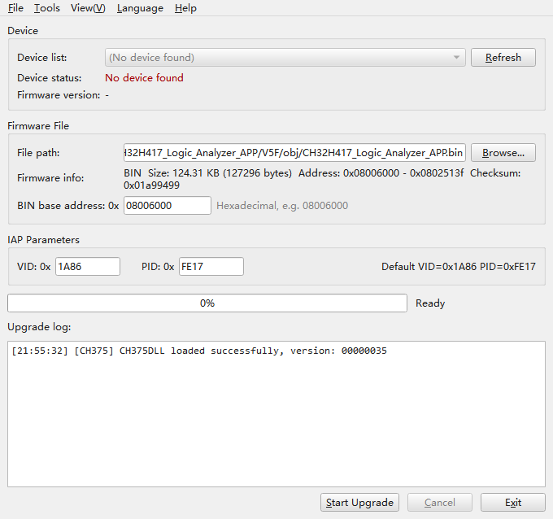

# CH32H417 Logic Analyzer Firmware Upgrade Tool

[简体中文](README_zh_CN.md)

A firmware upgrade tool for the **WeAct Studio Logic Analyzer V2 (U3LogicAnalyzer)**,
shipping a graphical and a console build. Each is a single exe — nothing else to
install, no Qt runtime required.

It takes Intel HEX (`.hex`) and raw binary (`.bin`) firmware, finds the board on any
of the three USB channels (CH375 / libusb / serial), programs a single APP slot, or
writes all slots in one bootloader session.

## Features

- Enumerates the board and reads its firmware version in every mode: application
  (VID `1A86` / PID `5537`), IAP (HID, `1A86` / `FE17`) and USB-to-UART + DAP
  (`1A86` / `5540`)
- Full IAP flow **erase → program → verify → finish** on a background thread, so
  the UI stays responsive
- Live progress bar, status line and colored log; the log can also be written to a file
- V2 boards program per APP slot: slot 0 `0x08006000`, slot 1 `0x08052000`,
  slot 2 `0x0809E000`
- Bootloader control without a firmware file: reboot into IAP, leave IAP, switch
  and boot a slot
- Batch mode: write several slots in one session — usable for production
- UI in English / 简体中文 / Русский / Deutsch / Español, switched on the fly, plus
  system dark / light theme

## Quick start



1. Connect the analyzer, start the program and click **Refresh** to confirm the
   board is listed.
2. Pick a `.hex` / `.bin` file or drop it onto the window. On a V2 the BIN slot
   comes from a dropdown, and the address range shown next to the file is exactly
   what will be programmed.
3. Click **Start Upgrade** and wait. The board reboots into the new firmware.
4. To only put the board into its bootloader, click **Reboot into IAP** — no
   firmware file involved.

> A board that is already in IAP mode (for example powered on with KEY held, so it
> only shows up as an HID device) is detected and the "enter IAP" step is skipped.

## APP slots and bootloader control

| Slot | Base address | Contents |
|---|---|---|
| 0 | `0x08006000` | Logic analyzer firmware |
| 1 | `0x08052000` | USB-to-UART + DAP firmware |
| 2 | `0x0809E000` | Example application |

Beyond downloading firmware, the bootloader answers two host commands that need
no firmware file:

| Command | Effect |
|---|---|
| `0x85` reboot | Acknowledges, then soft-resets the chip and runs the active slot |
| `0x86` set slot | `data[0]` = slot; stores it in the config area and boots it at once (an empty slot is refused) |

The graphical program offers both next to **Start Upgrade**, adapting to the
board's state:

| Board state | Buttons |
|---|---|
| Application mode | **Reboot into IAP** |
| IAP mode | **Reboot into:** `Slot 0` `Slot 1` `Slot 2`, plus **Leave IAP** |
| No device | buttons hidden |

The same actions on the command line:

```bat
rem reboot a running board into its bootloader (no firmware needed)
"CH32H417 Logic Analyzer Upgrade CLI.exe" --enter-iap

rem make slot 1 active and boot it (needs a board in IAP mode)
"CH32H417 Logic Analyzer Upgrade CLI.exe" --slot 1

rem reboot into the active slot
"CH32H417 Logic Analyzer Upgrade CLI.exe" --reboot
```

`--slot` and `--reboot` exit with `3` when no board is in IAP mode and with `4`
when the bootloader refuses (for example the target slot is empty). The bootloader
itself lives outside the three APP slots and can only be replaced over SWD, so a
board whose bootloader does not know these commands needs that update first.
**Reboot into IAP** always works, because it only uses the enter-IAP command the
application firmware already supports.

> Slot 2 (example application) does not enumerate USB: after flashing slot 2 alone
> the board disappears from the list and needs a KEY hold to switch slots or to
> enter IAP. Batch mode does not jump between slots, so it is not affected.

## USB channels

A board in application mode (`1A86` / `5537`) is reachable over two channels. The
USB protocol is identical on both — only the driver owning the device differs:

| Channel | Windows driver | Dependency | Shown as |
|---|---|---|---|
| CH375 | `CH375WDM.sys` (WCH driver) | `CH375DLL64.DLL`, loaded dynamically | `#0 … (CH375)` |
| libusb | WinUSB / libusbK / libusb-win32 | libusb-1.0, statically linked | `USB#0 … (libusb)` |

A device can only be claimed by one driver at a time, so a board shows up on one
channel only. The program enumerates both and uses whichever it can open — no
configuration needed:

- Board bound to the WCH driver → the CH375 channel is used, nothing to do.
- Board bound to WinUSB (the setup PulseView and other libusb tools use — install
  it with [Zadig](https://zadig.akeo.ie/) for `1A86:5537`, **WinUSB**) → the
  libusb channel is used. The CH375 driver cannot open such a board, which is why
  this channel exists.
- A board already in IAP mode is an HID device, always enumerated through hidapi,
  independent of the channel.

If the USB IDs match but the board is **in use by another program** (for instance
the analyzer software holding the WinUSB device), it is still listed and marked
`[in use]`; the upgrade then tells you to close that program instead of reporting
"no device found".

### Serial channel (USB-to-UART + DAP firmware)

The slot 1 firmware provides two functions at once: three COM ports (CDC) and a
**CMSIS-DAP** debug interface, enumerated as a single composite device
(`1A86` / `5540`). The tool lists it as one entry, `COM5 … (serial)` — the three
ports are equivalent, only one of them is shown.

That firmware accepts commands through the `SET_LINE_CODING` baud rate: opening
the port at **2048 baud** reboots the board into its IAP bootloader, which is what
the tool does when you select the serial device and start an upgrade. The serial
channel shows no firmware version (that firmware has no version command), and the
COM port must not be held open by another program (a serial terminal, for example)
when the upgrade starts.

The DAP interface runs over WinUSB — Windows binds it automatically through the
MS OS descriptors, no driver installation needed. It can flash and debug other
MCUs and does not interfere with this tool.

## Command line usage

The build produces two executables that share the same command line code:

| Executable | Subsystem | Purpose |
|---|---|---|
| `CH32H417 Logic Analyzer Upgrade.exe` | GUI | Graphical program; opens its window without arguments, hands the command line to the console build with arguments |
| `CH32H417 Logic Analyzer Upgrade CLI.exe` | Console | Command line program, never opens a window — **use this one in scripts** |

The console build is a plain Windows console application: `cmd` and PowerShell both
wait for it, and its output can be redirected or piped. The graphical build looks
for the console build next to itself and forwards its arguments, so `--list` works
either way — but PowerShell does not wait for a GUI process, so use
`Start-Process -Wait` or the console build directly when that matters.

Any argument selects headless mode; no arguments opens the graphical window.

| Option | Description |
|---|---|
| `-f`, `--firmware <path>` | Firmware file (`.hex` or `.bin`), required for a single-slot upgrade |
| `-d`, `--device <selector>` | Device index (`0..15`) or a USB serial prefix (also `-d COM5`) |
| `-b`, `--base <hex>` | Base address for `.bin` files (default `08006000`) |
| `--iap-vid <hex>` | VID in IAP (HID) mode (default `1A86`) |
| `--iap-pid <hex>` | PID in IAP (HID) mode (default `FE17`) |
| `-w`, `--wait <seconds>` | Seconds to wait for the IAP device (default `15`) |
| `--libusb` | Prefer the libusb / WinUSB channel |
| `--log <path>` | Append the upgrade log to a file |
| `-q`, `--quiet` | Print only progress, errors and the result |
| `--verbose` | Also print the CH375 driver diagnostics |
| `--slot0/1/2 <path>` | Batch mode: firmware for that slot |
| `--activate <0\|1\|2\|none>` | Slot to boot after a batch (default: the last one; `none` keeps the current one) |
| `--dry-run` | Check files, slots and device, then stop without writing |
| `-l`, `--list` | List the attached devices and exit |
| `--enter-iap` | Reboot a running board into its bootloader, no firmware needed |
| `--reboot` | Reboot a board in IAP mode into its active slot |
| `--slot <0\|1\|2>` | Make that slot active and boot it |
| `-h`, `--help` / `--version` | Show usage / version and exit |

Batch mode (`--slot0/1/2`) replaces `-f` and writes every named slot in one
bootloader session: no `CMD_IAP_END` between slots, each image padded to the 8 KB
flash page, and `--activate` closes the run (`none` just reboots). Run `--dry-run`
once before a production run.

Exit codes:

| Code | Meaning |
|---|---|
| `0` | Success |
| `1` | Usage / argument error |
| `2` | Firmware file error (missing or unparsable) |
| `3` | No usable device found |
| `4` | Upgrade failed |

Examples:

```bat
rem list the attached devices
"CH32H417 Logic Analyzer Upgrade CLI.exe" --list

rem upgrade with an Intel HEX file
"CH32H417 Logic Analyzer Upgrade CLI.exe" -f firmware.hex

rem flash a .bin at 0x08006000 to device 0, quiet output
"CH32H417 Logic Analyzer Upgrade CLI.exe" -f app.bin -b 08006000 -d 0 -q

rem pick the board by serial number and write a log
"CH32H417 Logic Analyzer Upgrade CLI.exe" -f app.bin -d b5e339 -w 20 --log upgrade.log

rem the board is bound to WinUSB (used by PulseView): prefer the libusb channel
"CH32H417 Logic Analyzer Upgrade CLI.exe" -f app.bin --libusb

rem write two slots in one pass, then boot slot 0
"CH32H417 Logic Analyzer Upgrade CLI.exe" --slot0 la.hex --slot2 demo.bin --activate 0

rem show what a batch would do, without touching the flash
"CH32H417 Logic Analyzer Upgrade CLI.exe" --slot0 la.hex --slot1 uart.bin --dry-run
```

Notes:

- The firmware file is parsed **before** the board is switched to IAP, so a broken
  file never leaves it stuck in the bootloader.
- `--list` prints one line per board; the trailing `(CH375)` / `(libusb)` names the
  channel and `IAP` marks a board already in the bootloader.
- Progress is printed as `[<total>%] <step> ... <step>%`, one line per 10% step
  plus one line when a step starts, e.g. `[ 31%] Programming FLASH ... 10%`.
- There is no *Cancel* button: an upgrade runs to the end once started, closing the
  window asks for confirmation, and a failure tells you to power-cycle the board
  and try again.

## Upgrade protocol

| Stage | Channel | Description |
|---|---|---|
| Enter IAP | CH375 pipe 1, or libusb EP `0x01` | Send `0xAE` (CMD_SET_IAP); firmware sets the jump flag and resets |
| Erase | HID (`1A86` / `FE17`) | `0x81` + 4-byte start address (little-endian) |
| Program | HID | `0x80` + length (≤62) + data; a zero-length packet ends the data phase |
| Verify | HID | `0x82` + length (≤56) + 4-byte address + data |
| Finish | HID | `0x83`; firmware clears the IAP flag and jumps to the app (usually no response) |

Response packet: `[0]=0x00, [1]=error code`; `0x00` means success.

## Building from source

Requires MSYS2 MINGW64 with the Qt 6 static libraries
(`mingw-w64-x86_64-qt6-static`, `hidapi`, `libusb` and Qt's image/codec
dependencies); Qt 5 static libraries are optional.

```bash
./build.sh          # build (Qt6 by default)
./build.sh test     # build and run the unit tests
./build.sh clean    # clean
```

`build.bat` does the same in one click. Output lands in `build/`: the GUI build is
about 31 MB, the console build about 12 MB (QtCore only), and the script copies
`CH375DLL.dll` / `CH375DLL64.dll` next to them.

## License

GPL-3.0-or-later, Copyright (C) 2026 WeAct Studio.
