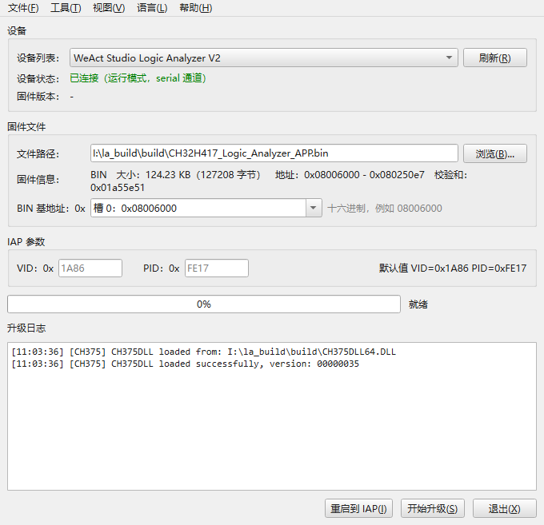

# CH32H417 逻辑分析仪固件升级工具

[English](README.md)

用于 **WeAct Studio Logic Analyzer V2（U3LogicAnalyzer）** 的固件升级工具，提供
图形界面与控制台两个版本，单个 exe 即可运行，无需安装 Qt 或其它运行时。

支持 Intel HEX（`.hex`）与原始二进制（`.bin`）固件，三条 USB 通道（CH375 /
libusb / 串口）自动识别，可单独升级某个 APP 槽，也可在一次会话中批量写入三个槽。

## 主要功能

- 自动枚举设备并读取固件版本：运行模式（VID `1A86` / PID `5537`）、IAP 模式
  （`1A86` / `FE17`）、USB 转串口 + DAP 固件（`1A86` / `5540`）均可识别
- 完整 IAP 流程 **擦除 → 编程 → 校验 → 结束**，后台线程执行，界面不卡
- 实时进度条、状态与彩色日志；可把日志同时写入文件
- V2 板子按槽位烧录：槽 0 `0x08006000`、槽 1 `0x08052000`、槽 2 `0x0809E000`
- 无需固件的引导程序控制：重启进 IAP、退出 IAP、切换并启动指定槽
- 支持批量模式：一次会话写完多个槽，量产可用
- 界面支持 English / 简体中文 / Русский / Deutsch / Español，切换即时生效；
  跟随系统深色 / 浅色主题

## 快速上手



1. 连接逻辑分析仪，运行程序，点 **刷新** 确认设备已识别。
2. 选择或直接拖入 `.hex` / `.bin` 固件（V2 上 .bin 的槽位由下拉框选择，
   文件旁显示的地址范围就是实际烧录范围）。
3. 点 **开始升级**，等待完成；设备自动重启并运行新固件。
4. 只想把板子送进引导程序时，点 **重启到 IAP**，不需要固件文件。

> 设备已处于 IAP 模式（例如按住 KEY 上电，只显示 HID 设备）时，程序会自动识别
> 并跳过「进入 IAP」这一步。

## APP 槽与引导程序控制

| 槽 | 基地址 | 用途 |
|---|---|---|
| 0 | `0x08006000` | 逻辑分析仪固件 |
| 1 | `0x08052000` | USB 转串口 + DAP 固件 |
| 2 | `0x0809E000` | 示例 APP |

除下载固件外，引导程序还支持两个不需要固件文件的主机命令：

| 命令 | 作用 |
|---|---|
| `0x85` 重启 | 先应答，再软复位整机，运行当前槽 |
| `0x86` 切换槽位 | `data[0]` = 槽号，写入配置区并立即启动（空槽会被拒绝） |

图形界面把这两个操作放在「开始升级」旁的按钮区，随设备状态变化：

| 设备状态 | 按钮 |
|---|---|
| 运行模式 | **重启到 IAP** |
| IAP 模式 | **重启到：** `槽 0` `槽 1` `槽 2`，以及 **退出 IAP** |
| 无设备 | 按钮隐藏 |

命令行等价用法：

```bat
rem 运行模式的板子重启进引导程序（不需要固件）
"CH32H417 Logic Analyzer Upgrade CLI.exe" --enter-iap

rem 把槽 1 设为当前槽并启动（设备需处于 IAP 模式）
"CH32H417 Logic Analyzer Upgrade CLI.exe" --slot 1

rem 重启到当前槽
"CH32H417 Logic Analyzer Upgrade CLI.exe" --reboot
```

`--slot` / `--reboot` 在没有 IAP 设备时返回 `3`，引导程序拒绝请求时返回 `4`
（例如目标槽为空）。引导程序本身不在三个 APP 槽内，只能通过 SWD 更新；板子上的
引导程序不支持上述命令时，需先用 SWD 更新一次。**重启到 IAP** 任何时候都可用，
因为它只用 APP 固件早已支持的进入 IAP 命令。

> 槽 2（示例 APP）不枚举 USB：单独烧完槽 2 后设备会「失联」，需长按 KEY 切槽
> 或上电时按住 KEY 进 IAP。批量模式中途不跳转，因此不受影响。

## USB 通道

运行模式的板子（`1A86` / `5537`）有两条通道，USB 协议完全相同，区别只是设备被
哪个驱动占有：

| 通道 | Windows 驱动 | 依赖 | 列表显示 |
|---|---|---|---|
| CH375 | `CH375WDM.sys`（沁恒驱动） | `CH375DLL64.DLL`，动态加载 | `#0 … (CH375)` |
| libusb | WinUSB / libusbK / libusb-win32 | libusb-1.0，静态链接 | `USB#0 … (libusb)` |

一个设备同一时刻只能被一个驱动占有，所以一块板子只会出现在其中一条通道上。
程序同时枚举两条通道、用能打开的那一条，无需配置：

- 板子绑沁恒驱动 → 走 CH375 通道，不需要额外操作。
- 板子绑 WinUSB（PulseView 等 libusb 程序的配置，用
  [Zadig](https://zadig.akeo.ie/) 对 `1A86:5537` 安装 **WinUSB**）→ 走 libusb
  通道。此时 CH375 驱动打不开这块板子，这条通道正是为此存在。
- IAP 模式下的设备是 HID 设备，始终由 hidapi 枚举，与通道无关。

板子 USB ID 匹配但**正被其它程序占用**（例如上位机占着 WinUSB 设备）时，设备
仍会列出并标记 `[in use]`，升级会明确提示先关闭占用它的程序。

### 串口通道（USB 转串口 + DAP 固件）

槽 1 的固件同时提供两个功能：3 个串口（CDC）和一个 **CMSIS-DAP** 调试接口，
枚举为单个复合设备（`1A86` / `5540`）。工具把它列为**一个**条目
`COM5 … (serial)`（三个串口等价，只显示其中一个）。

该固件通过 `SET_LINE_CODING` 的波特率字段接收命令：以 **2048 波特** 打开 COM 口
即可让板子复位进 IAP，工具在选中 serial 设备并开始升级时正是这样做的。串口通道
不显示固件版本（该固件没有版本命令）；升级开始时 COM 口不能被串口终端等程序占用。

DAP 接口走 WinUSB（Windows 通过 MS OS 描述符自动绑定，无需装驱动），可以用它
给其它 MCU 下载与调试，不影响升级工具正常工作。

## 命令行用法

构建产出两个可执行文件，共用同一套命令行代码：

| 可执行文件 | 子系统 | 用途 |
|---|---|---|
| `CH32H417 Logic Analyzer Upgrade.exe` | GUI | 图形界面；不带参数开窗口，带参数则转交控制台版 |
| `CH32H417 Logic Analyzer Upgrade CLI.exe` | 控制台 | 命令行程序，永不开窗口；**脚本请用这个** |

控制台版是标准 Windows 控制台程序：`cmd` 与 PowerShell 都会等它结束，输出可被
重定向或管道接管。图形界面版会自动找到同目录的控制台版并转发参数，所以
`--list` 两种写法都行；但 PowerShell 不会等待 GUI 进程，需要等待时用
`Start-Process -Wait` 或直接用控制台版。

带任意参数即进入无窗口模式；不带参数则打开图形界面。

| 参数 | 说明 |
|---|---|
| `-f`, `--firmware <路径>` | 固件文件（`.hex` 或 `.bin`），单槽升级时必填 |
| `-d`, `--device <选择>` | 设备索引（`0..15`）或 USB 序列号前缀（也可 `-d COM5`） |
| `-b`, `--base <十六进制>` | `.bin` 的烧录基地址（默认 `08006000`） |
| `--iap-vid <十六进制>` | IAP（HID）模式 VID（默认 `1A86`） |
| `--iap-pid <十六进制>` | IAP（HID）模式 PID（默认 `FE17`） |
| `-w`, `--wait <秒>` | 等待 IAP 设备出现的秒数（默认 `15`） |
| `--libusb` | 优先使用 libusb / WinUSB 通道 |
| `--log <路径>` | 同时把升级日志追加写入文件 |
| `-q`, `--quiet` | 只打印进度、错误与最终结果 |
| `--verbose` | 同时打印 CH375 驱动诊断信息 |
| `--slot0/1/2 <路径>` | 批量模式：对应槽的固件 |
| `--activate <0\|1\|2\|none>` | 批量烧完后启动哪个槽（默认最后一个，`none` 保持当前槽） |
| `--dry-run` | 只检查文件、槽位与设备，不写 flash |
| `-l`, `--list` | 列出当前连接的设备后退出 |
| `--enter-iap` | 把运行模式的设备重启进引导程序，不需要固件 |
| `--reboot` | 把 IAP 模式的设备重启到当前槽 |
| `--slot <0\|1\|2>` | 把指定槽设为当前槽并启动 |
| `-h`, `--help` / `--version` | 显示用法 / 版本后退出 |

批量模式（`--slot0/1/2`）代替 `-f`，在一次引导程序会话里写完所有指定槽：槽与槽
之间不发 `CMD_IAP_END`，每个镜像补齐到 8 KB flash 页边界，最后由 `--activate`
收尾（`none` 则只做一次复位）。量产前建议先跑一遍 `--dry-run`。

退出码：

| 代码 | 含义 |
|---|---|
| `0` | 成功 |
| `1` | 参数 / 用法错误 |
| `2` | 固件文件错误（不存在或无法解析） |
| `3` | 没有找到可用设备 |
| `4` | 升级失败 |

示例：

```bat
rem 列出当前连接的设备
"CH32H417 Logic Analyzer Upgrade CLI.exe" --list

rem 用 Intel HEX 升级
"CH32H417 Logic Analyzer Upgrade CLI.exe" -f firmware.hex

rem 以 0x08006000 为基地址把 bin 烧到 0 号设备，精简输出
"CH32H417 Logic Analyzer Upgrade CLI.exe" -f app.bin -b 08006000 -d 0 -q

rem 按序列号选设备并写日志
"CH32H417 Logic Analyzer Upgrade CLI.exe" -f app.bin -d b5e339 -w 20 --log upgrade.log

rem 板子绑的是 WinUSB（PulseView 在用）：优先走 libusb 通道
"CH32H417 Logic Analyzer Upgrade CLI.exe" -f app.bin --libusb

rem 一次写完两个槽，然后启动槽 0
"CH32H417 Logic Analyzer Upgrade CLI.exe" --slot0 la.hex --slot2 demo.bin --activate 0

rem 预演一次批量烧录，不碰 flash
"CH32H417 Logic Analyzer Upgrade CLI.exe" --slot0 la.hex --slot1 uart.bin --dry-run
```

说明：

- 固件在设备切换进 IAP **之前**解析，文件有问题不会把板子留在引导程序里。
- `--list` 每行一块板子，末尾 `(CH375)` / `(libusb)` 是通道，`IAP` 表示已处于
  引导程序。
- 进度按 `[<总进度>%] <步骤> ... <步骤进度>%` 打印，每跨 10% 一行，每个步骤开始
  另有一行，例如 `[ 31%] Programming FLASH ... 10%`。
- 界面没有"取消"按钮：升级一旦开始会执行到底，关闭窗口会弹确认；失败时日志与
  提示都会要求重新上电后再试。

## 升级协议

| 阶段 | 通道 | 说明 |
|---|---|---|
| 进入 IAP | CH375 管道 1，或 libusb EP `0x01` | 发送 `0xAE`(CMD_SET_IAP)，固件写跳转标志后复位 |
| 擦除 | HID（`1A86` / `FE17`） | `0x81` + 4 字节起始地址（小端） |
| 编程 | HID | `0x80` + 长度(≤62) + 数据，数据发完再发一个长度 0 的包 |
| 校验 | HID | `0x82` + 长度(≤56) + 4 字节地址 + 数据 |
| 结束 | HID | `0x83`，固件清除 IAP 标志并跳转 APP（通常无应答） |

响应包格式：`[0]=0x00, [1]=错误码`，`0x00` 表示成功。

## 从源码构建

需要 MSYS2 MINGW64 与 Qt 6 静态库（`mingw-w64-x86_64-qt6-static`、`hidapi`、
`libusb` 及 Qt 依赖的图形库），可选 Qt5 静态库：

```bash
./build.sh          # 构建（默认 Qt6）
./build.sh test     # 构建并运行单元测试
./build.sh clean    # 清理
```

也可双击 `build.bat` 一键构建。产物在 `build/`：图形界面版约 31 MB，控制台版
约 12 MB（只链 QtCore），脚本会自动把 `CH375DLL.dll` / `CH375DLL64.dll` 复制过去。

## 许可

本项目按 **GNU 通用公共许可证第 3 版或更高版本（GPL-3.0-or-later）** 发布，
Copyright (C) 2026 WeAct Studio。许可证全文见仓库根目录的 [LICENSE](LICENSE)，
官方文本见 <https://www.gnu.org/licenses/gpl-3.0.html>。

本程序不提供任何担保；分发修改后的版本时，须同样以 GPL 公开源代码。
